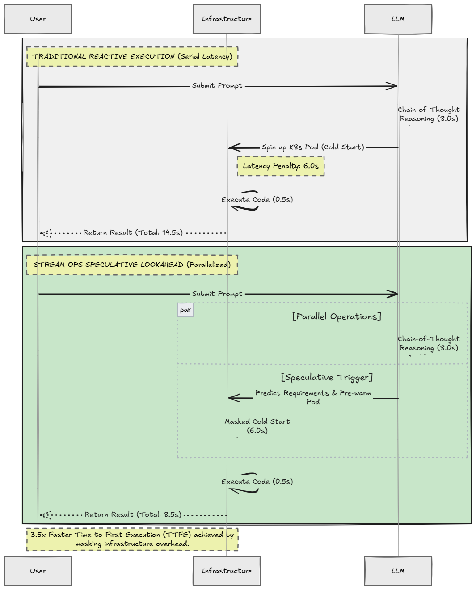

# Stream-Ops 2.0: Speculative Infrastructure Pre-Warming via Chain-of-Thought Lookahead

[](https://github.com/yashrajshuklaaa/StreamOps2.0/actions/workflows/ci.yml)
[](https://opensource.org/licenses/MIT)
[](https://www.python.org/downloads/)
[](https://kubernetes.io/)
[](https://helm.sh/)
[](https://opentelemetry.io/)

**Stream-Ops** is a research prototype exploring speculative sandbox prewarming for tool-using LLM agents. Its local Go/Rust implementation can inspect streamed Ollama response text and create a Kubernetes pod. Performance improvements and agent tool execution have not yet been evaluated.

---

## Architecture / Sequence Diagram

This is a conceptual target diagram; it does not represent every implemented component.



### Current prototype
- Scores streamed Ollama response text using keyword matching and TF-IDF-style similarity.
- Applies a heuristic threshold based on static tool-cost profile values; scores are not calibrated probabilities.
- Creates a real Kubernetes sandbox pod and supports claiming and TTL cleanup.
- Exposes Prometheus metrics.

The current system is not a production operator, does not execute tool payloads in the sandbox, and does not provide verified performance results. See the [research paper](docs/RESEARCH_PAPER.md) for limitations and evaluation status.

---

## Go + Rust Real Kubernetes Prototype

This repository now includes a real local Kind implementation in `services/`:

- `services/intent-engine/`: Rust streaming intent engine with keyword, TF-IDF-like, and Bayesian threshold decisions.
- `services/control-plane/`: Go Ollama-compatible streaming gateway with real Kubernetes pod provisioning, claiming, readiness tracking, TTL cleanup, and Prometheus metrics.
- `deploy/kind/`: Kind cluster and Kubernetes deployment manifests.

Start the complete local stack:

```bash
./scripts/run-kind.sh
```

The control plane is exposed at `http://localhost:8000`. Pull a model and send a live streaming request:

```bash
kubectl exec -n streamops deployment/ollama -- ollama pull llama3.2:1b

curl --no-buffer \
  -H "Content-Type: application/json" \
  -d '{"model":"llama3.2:1b","prompt":"Analyze the dataset using Python and pandas.","stream":true}' \
  http://localhost:8000/api/generate
```

The generated response includes `X-StreamOps-Session-ID`. Claim the pre-warmed Python pod with that session ID:

```bash
curl -X POST \
  -H "Content-Type: application/json" \
  -d '{"tool_name":"python"}' \
  http://localhost:8000/v1/sessions/<session-id>/claim
```

Useful checks:

```bash
curl http://localhost:8000/readyz
curl http://localhost:8000/metrics
kubectl get pods -n streamops
```

---

## 🚀 Quickstart

### 1. Install Dependencies
```bash
pip install -r requirements.txt
```

### 2. Run the Stream-Ops Control Plane & Web Visualizer
```bash
python stream_proxy.py
# Or: uvicorn streamops.proxy.server:app --port 8000
```
Open **[http://localhost:8000/dashboard](http://localhost:8000/dashboard)** in your browser to access the interactive live visualizer!

### 3. Run the SIMULATED Benchmark
```bash
python benchmarks/benchmark_suite.py
```
This computes example values from fixed assumptions; it does not measure model or Kubernetes latency.

### 4. Run the Unit & Integration Test Suite
```bash
pytest tests/ -v
```

---

## 📊 Evaluation Status

**Performance evaluation: not yet conducted.** The repository currently has no retained raw benchmark traces or results under `results/`. The legacy benchmark script is a simulation based on assumptions and is not empirical evidence. No TTFE speedup, cold-start masking, cloud-cost saving, or proxy-overhead measurement is claimed. Details and planned metrics are in the [research paper](docs/RESEARCH_PAPER.md).

---

## 🏗️ Cloud & DevOps Infrastructure

```
deploy/
├── docker-compose.yml              # Local multi-service orchestration (Proxy + Prom + Grafana + Jaeger + Redis)
├── Dockerfile                      # Production multi-stage non-root container
├── helm/stream-ops/                # Helm chart prototype
├── terraform/                      # Terraform infrastructure examples
└── observability/
    ├── prometheus.yml              # Prometheus scraper configuration
    └── dashboards/
        └── streamops-overview.json # Grafana monitoring dashboard
```

---

## 📄 Academic Research Paper

Read the current prototype report and evaluation status:
👉 **[docs/RESEARCH_PAPER.md](docs/RESEARCH_PAPER.md)**  

---

## 📜 License
MIT License. Open source for academic research and cloud engineering communities.
