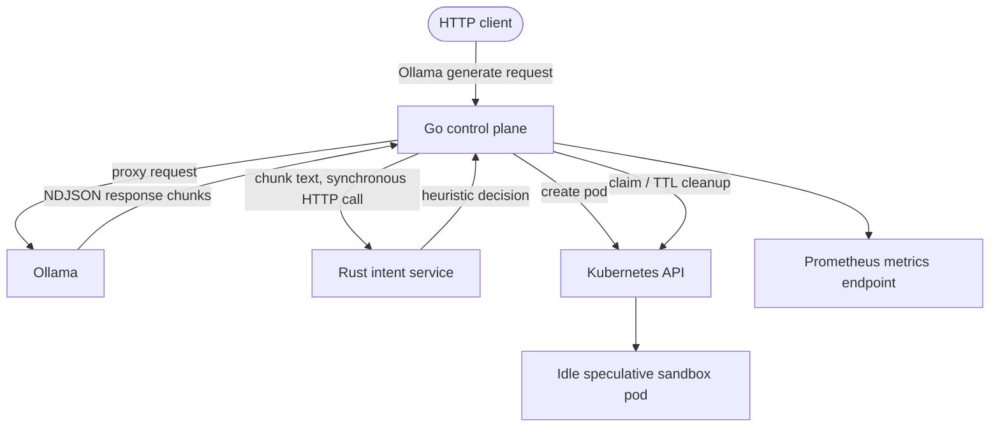

# System Architecture

This diagram describes the current local prototype, not a production operator or a measured high-throughput system.

## Architecture Components

### 1. Go Ollama proxy (`services/control-plane/`)

Proxies Ollama's newline-delimited `/api/generate` route and inspects each
response chunk. OpenAI and Anthropic adapters in the legacy Python tree are
not used by this Go service. The prototype does not claim access to private
reasoning.

### 2. Rust intent scorer (`services/intent-engine/`)

Maintains a bounded per-session text buffer, performs keyword checks and
TF-IDF-style lexical similarity, and compares a heuristic score against a
threshold derived from static profile values. The score is not a calibrated
probability. No per-token latency target has been measured.

### 3. Go Kubernetes lifecycle (`services/control-plane/`)

Creates a named pod in a configured namespace, exposes a claim endpoint that
marks it claimed and waits for readiness, and periodically deletes expired
unclaimed pods. The sandbox process is idle; the claim endpoint does not
execute a tool payload. Session-specific pod names and labels are not, by
themselves, a security isolation guarantee.

## Not implemented or evaluated

The current Go/Rust path is not a Kubernetes operator and has no CRDs, gRPC
API, provider-adapter suite, lock-free side channel, OpenTelemetry spans,
preemptible sandbox class, or end-to-end agent tool execution. Prometheus
metrics are exposed, but a production observability stack and performance
evaluation are not established by the prototype.
